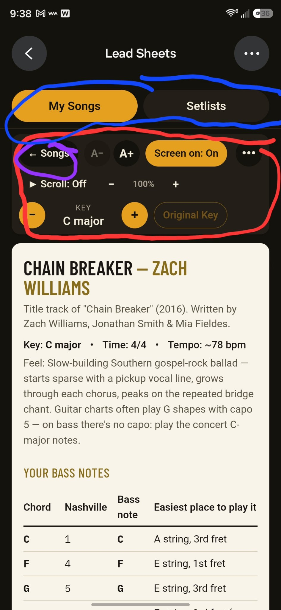
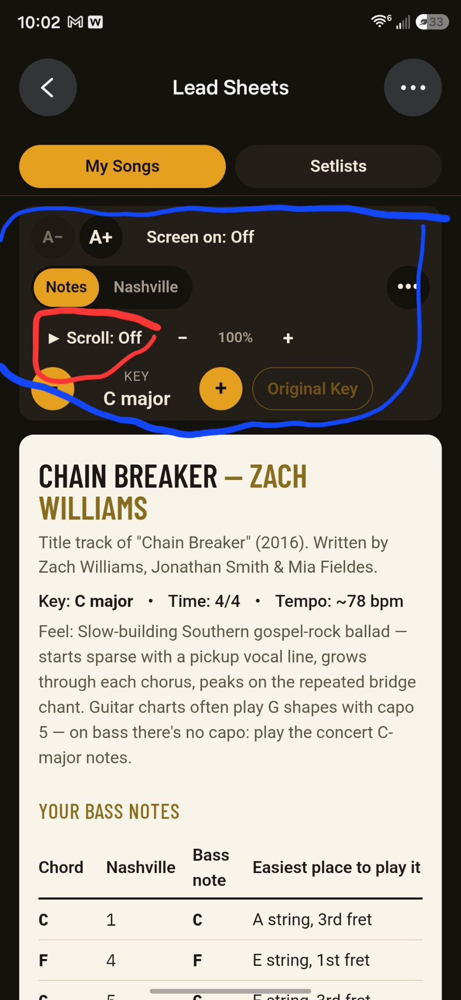
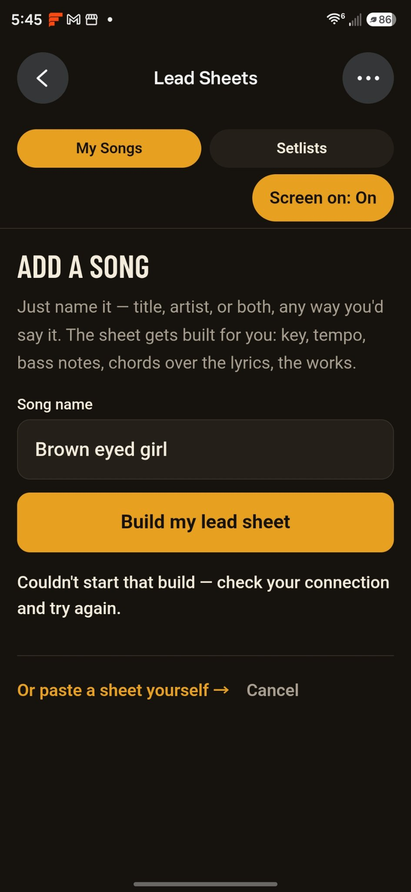

# Lead Sheets App — Handoff Log & Build Spec

**Prepared:** November 11, 2026, by Cooper (Muse) for Brian Prewitt.
**Purpose:** Everything needed for a fresh developer or agent to rebuild, host, or take over the Lead Sheets app — what it is, how it behaves, the exact data model, the full song/setlist inventory, and the hard lessons baked into its current behavior.
**Status:** This package is *preparation only*. Brian parked the hosting decision on Nov 11, 2026 (see "History & handover options" at the end). Nothing has been transferred.

**Package contents**

| File | What it is |
|---|---|
| `lead-sheets-app-handoff.md` | This document — the spec and handoff log |
| `lead-sheets-data-export.json` | Complete data export: all 16 song records (full content) + both setlists with ordered song IDs |
| `screenshots/` | Three screenshots of the live app from Brian's phone (see "Screenshots" section) |

---

## 1. What the app is

Lead Sheets is a personal lead-sheet library and live-performance viewer for one user: **Brian Prewitt, a bass guitar player** (learning bass; plays worship sets and covers). It runs on his phone and tablet, in the browser, and is used in two situations:

1. **Practice** — big, readable lead sheets with the chords printed over the lyrics, a bass-notes table (root note + Nashville number + easiest fret position for every chord), plain-language "how to play it" guidance, and a practice tip per song.
2. **Live performance** — a setlist view ("Live Mode") with a screen wake lock so the phone doesn't sleep mid-song, tempo-based auto-scroll so the sheet moves at the song's pace hands-free, tap-to-advance through the setlist, instant key transposition, and a Notes ⇄ Nashville numbers toggle.

**Ownership/licensing posture (important):** this is a *bring-your-own-songs* app. There is **no shared or pooled song library** and there must never be one: each user/band/church builds and keeps its own private library ("private locker" model). This posture is deliberate — pooled/shared libraries of copyrighted lead sheets are not licensable under SongSelect/CCLI terms. Lyrics live per-user only. Any rebuild must keep this posture.

**Current host:** a server-backed web app built with Cooper inside Muse (Nov 10–11, 2026). Because it is server-backed, Muse cannot issue it a public share link — that limitation is the entire reason this handover package exists.

---

## 2. Screens and navigation

Top-level structure: a shell header (back arrow ‹, app title, ••• menu) above a two-tab bar.

- **My Songs tab** — the library: a scrollable list of all songs (title, artist, key, tempo). Tapping a song opens the song view. An "Add a Song" entry point opens the Add a Song screen. While a song is being generated (see §7), a **"Building…" banner** shows on this list.
- **Setlists tab** — list of setlists; create, rename, delete setlists; a setlist editor to add/remove/reorder songs; launching a setlist opens **Live Mode**.
- **Song view** — the lead sheet itself (see §3 for the content format), topped by the sticky control header (see §9). The ••• overflow menu in the header holds **Edit** and **Delete** for the song. Edit opens the full song editor (every field of the data model, §4) — any section of any sheet can be fixed by hand there.
- **Live Mode** — full-screen performance view of a setlist: current song's sheet, the same sticky controls (transpose, Notes/Nashville, auto-scroll, Screen on), and prev/next navigation through the setlist in order. Auto-scroll state resets when the song changes.
- **Add a Song screen** — one text field ("Song name") + a "Build my lead sheet" button, plus a secondary "Or paste a sheet yourself →" link to the manual paste-in form. See §7.
- **Back navigation:** the shell header's back arrow (‹) is the way back from a song. There is deliberately **no** second "← Songs" button inside the song view (duplicate removed at Brian's request, Nov 10).

The **My Songs / Setlists tab bar is thin** (36px-tall buttons, tight padding) — Brian found the original fat tab bar wasted too much phone screen.

---

## 3. The lead-sheet format (what a sheet looks like)

Every sheet renders the same way, top to bottom:

1. **Title block** — song title and artist, large type.
2. **About line** — the album/source blurb (`sourceNote`, e.g. "Title track of *Chain Breaker* (2016). Written by…").
3. **Key / Time / Tempo line** — e.g. "Key: C major • Time: 4/4 • Tempo: ~78 bpm", rendered from `keyLabel`, `timeSignature`, `tempo` + `tempoNote`.
4. **Feel paragraph** — `feel`: one or two sentences on the groove/character.
5. **"Your Bass Notes" table** — `bassNotes`: one row per distinct chord in the song, with columns **Chord | Nashville | Bass note | Easiest place to play it**. This table is the heart of the format for a bass learner: root note on beat 1 is the core guidance.
6. **How to play** — `howToPlay`: a paragraph of concrete playing guidance (where the roots go, the one signature move, dynamics).
7. **The chart body** — `body`: the song section by section (see §4). Each section has a heading (INTRO, VERSE 1, CHORUS, BRIDGE, OUTRO…) and lines of **chords printed directly over the lyric words they land on** (monospaced chord line above its lyric line). Instrumental sections are given as bar lines (e.g. `| F#m | Esus | E |`), and player instructions appear as italic note lines.
8. **At a glance** — `atAGlance`: the whole song map on one line (Intro → Verse → Chorus → …), so the player can see the shape of the song at a glance.
9. **Practice tip** — `practiceTip`: the one thing to loop first.

The format rule that governs all content: **honesty over completeness.** If a section of a song can't be verified, the sheet says so (a placeholder note — see §5) instead of inventing music.

---

## 4. Data model (source of truth)

The data export (`lead-sheets-data-export.json`) is the ground truth; the field list below matches the app's `addsong` action exactly.

### Song record

| Field | Type | Meaning |
|---|---|---|
| `id` | integer | App-assigned song ID |
| `title` | string (required) | Song title, published form (e.g. "To The Table") |
| `artist` | string | Recording artist |
| `keyLabel` | string | Display key, e.g. "C major", "F# minor", "E major (E-centered)" — may carry a caveat |
| `keyRoot` | string | Root note of the key, e.g. "C", "F#", "Eb" — the anchor for transposition and Nashville conversion |
| `keyMode` | `"major"` \| `"minor"` | Mode of the key — drives the Nashville number mapping (natural-minor numbering for minor keys) |
| `keyNote` | string | A caveat/explainer about the key (capo charts, enharmonic spellings, "sounds Eb", etc.); may be empty |
| `tempo` | integer \| null | BPM to play at. **null when no single verified tempo exists** (see §5 — never invent one) |
| `tempoNote` | string | Tempo caveat (double-time analysis reads, two-tempo songs, published-vs-analysis differences) |
| `timeSignature` | string | Usually "4/4"; carries counting guidance where needed, e.g. "3/4 — waltz, count 1-2-3" or "7/4 on the verse riff — count 7, not 4" |
| `feel` | string | Groove/character paragraph |
| `sourceNote` | string | Album, year, writers, and any provenance/honesty notes about the chart |
| `atAGlance` | string | One-line song map (sections in order) |
| `howToPlay` | string | Playing guidance paragraph |
| `practiceTip` | string | Practice guidance — what to loop first |
| `bassNotes` | array | One object per distinct chord: `{chord, nashville, bassNote, position}` — chord name; its Nashville number **relative to this song's key** (may be "6m", "b7", "5 over 3", "5 / b7", etc.); the bass root note name; the easiest fret position in words (e.g. "E string, 3rd fret", "Open A string (2nd string)") |
| `body` | array | Sections in performance order: `{heading, lines[]}`. Each line is an object with any of: `chords` (monospaced chord line positioned over the lyric), `lyrics` (the lyric line), `bars` (a bar-line string for instrumental passages), `note` (an instruction/cue line) |

Chord-over-lyric alignment is positional: the `chords` string is rendered in a monospace font directly above its `lyrics` string, and the character columns are the alignment. Any rebuild must preserve the spacing exactly (this is also why the Nashville conversion in §9 must preserve column positions).

### Setlist record

`{id, name, songIds[]}` — `songIds` is the ordered list of song IDs; order is performance order.

### Generation job record (internal, for the add-a-song flow — see §7)

Tracked in a `generation_jobs` table: the raw user `request` text, `status` (working / done / failed / not-identified), the identification result (`meta`: title, artist, key, tempo, progression) and section outline (`structure`: ordered unique section headings), the `sections` written so far (heading → content), and the resulting `songId` once assembled.

---

## 5. Inventory — what's in the library

16 song records (IDs 1–16) and 2 setlists, exported in full in `lead-sheets-data-export.json`.

### Songs

| ID | Title | Artist | Key | Tempo | Time |
|---|---|---|---|---|---|
| 1 | Fire Away | Chris Stapleton | A major | 116 | 3/4 — waltz, count 1-2-3 |
| 2 | Neon Moon | Brooks & Dunn | A major | 102 | 4/4 |
| 3 | Say It Ain't So | Weezer | Eb major | 76 | 4/4 |
| 4 | The Middle | Jimmy Eat World | D major | 162 | 4/4 |
| 5 | Take Me Out | Franz Ferdinand | E minor | — (see caveat) | 4/4 |
| 6 | Jumper | Third Eye Blind | C major | 90 | 4/4 |
| 7 | Possum Kingdom | Toadies | E major (E-centered) | 101 | 7/4 on the verse riff — count 7, not 4 |
| 8 | Truth | Luke Bower | Bb major | 104 | 4/4 |
| 9 | To The Table | Zach Williams | A major | 68 | 4/4 |
| 10 | Chain Breaker | Zach Williams | C major | 78 | 4/4 |
| 11 | East to West | Casting Crowns | F# minor | 73 | 4/4 |
| 12 | no half steppin | sean costello | A major | — | 4/4 |
| 13 | No Half Steppin' | Sean Costello | A (practice version — recording key unverified) | — (unverified) | 4/4 |
| 14 | Give Me One Reason | Tracy Chapman | F# major | 100 | 4/4 |
| 15 | Born on the Bayou | Creedence Clearwater Revival | E major | 121 | 4/4 |
| 16 | Brown Eyed Girl | Van Morrison | G major | 149 | 4/4 |

Songs 1–11 and 13 were researched and written by Cooper directly. Songs 14–16 were produced by the app's own add-a-song flow (§7) on Nov 11, 2026 — the flow works; those three sheets are its proof.

### Setlists

| ID | Name | Order (song IDs → titles) |
|---|---|---|
| 1 | Worship Set | 11 East to West → 8 Truth → 10 Chain Breaker → 9 To The Table |
| 2 | Biker church | 10 Chain Breaker → 11 East to West → 9 To The Table → 8 Truth |

"Worship Set" is the four worship songs in the order Brian named them, aimed at a biker-church worship performance. "Biker church" is the same four songs in a different running order. "No Half Steppin'" is library-only — it is a blues song and belongs to neither setlist.

### Per-song caveats (do not "fix" these — they are deliberate)

- **ID 12 "no half steppin" (lowercase, artist "sean costello") is an empty duplicate stub of ID 13** — title/artist/key fields only, no body, no bass notes. It is safe to delete in any rebuild; keep ID 13, which is the real sheet.
- **ID 13 "No Half Steppin'" is a PRACTICE/FORM version, not a transcription.** No published chord chart, key, BPM, or transcription of the Sean Costello recording exists anywhere (checked Ultimate Guitar, Chordify, ChordU, PaidTabs, SongData, Shazam). The sheet is the standard 12-bar blues framework in A (A7–D7–E7, root–5th–♭7 shuffle walk) with the song's verified structure and hook lyric; the recording's actual key and tempo are **unverified** — the sheet itself says to check the key against the record. `tempo` is null.
- **ID 8 "Truth" (Luke Bower — note: no "s" in Bower):** no published chart exists for "Truth" itself. Its chords follow the Ultimate Guitar chart for the album's companion track "Spirit" (same verse and chorus), transposed from B to the recording's Bb. The sheet's `sourceNote` states this in full.
- **ID 5 "Take Me Out":** `tempo` is null on purpose — the song has two tempos (verse ~122 bpm, riff ~104 bpm), recorded in `tempoNote`. Auto-scroll falls back per §8.
- **ID 11 "East to West"** is by **Casting Crowns** (F# minor, *The Altar and the Door*, 2007). Brian originally named MercyMe; MercyMe has no song by this title. Writers Mark Hall & Bernie Herms. (MercyMe is not a typo to correct back.)
- **ID 9 "To The Table":** Brian's name for it, "Bring It All to the Table," is the chorus hook, not the published title.
- **ID 2 "Neon Moon"** is the 1991 original in A major — not the 2019 "Reboot" version (Eb).
- **Placeholder rule:** sheets generated by the app (§7) may contain honest placeholder lines where a section didn't come through — the standard wording is **"(OUTRO didn't come through — add it with Edit song.)"** (section name varies). This is by design: the generator must never invent a missing section. A rebuild must keep this behavior; placeholders are fixed later via Edit song.

---

## 6. Screen-on (wake lock)

- A **"Screen on: On/Off"** toggle sits in the top bar on **every** screen (library, setlists, song view, Live Mode).
- It uses the **Screen Wake Lock API** to keep the device awake while playing.
- The lock is **re-acquired automatically** when the app returns to the foreground (visibility change), since the OS releases wake locks when the page hides.
- The choice **persists in `localStorage` under the key `leadSheetsKeepAwake`**, and **defaults to On**.
- On browsers without wake-lock support it **no-ops silently** — no error, no nag. (Note for the handover options in §11: wake-lock behavior inside embedded/share-page frames is unverified.)

---

## 7. Adding songs

There are two paths. The LLM-style add is the primary one; the paste-in form is the fallback.

### 7a. Name it and the app builds the sheet (primary)

**User experience.** On the Add a Song screen the user types or dictates just a name — title, artist, or both, any way they'd say it ("no half steppin sean costello", "Brown eyed girl") — and taps **"Build my lead sheet."** The app then:

1. **Identifies the song** — resolves the loose input to a specific recording: title, artist, its real key, tempo, and chord progression.
2. **Writes the complete lead sheet** in exactly the data format of §4: bass-notes table (with Nashville numbers and fret positions), how-to-play, at-a-glance, practice tip, and the body section by section with chords aligned over the real lyrics.
3. **Adds it to the library** and lands the user on the finished song.

While it works, the UI shows **live progress** ("Writing the verse… 4 of 10 sections done") and a **"Building…" banner** on the song list.

**If the song can't be confidently identified, the app says so plainly and invents nothing** — no sheet is created. This is verified behavior, not a hope: given "no half steppin sean costello," the identifier correctly declined, because no published key/BPM/chart exists for that recording (Brian's sheet for it, ID 13, was later written by hand as a practice version — see §5).

**Architecture rules (each one was learned from a production failure on Nov 11, 2026 — see §11):**

- **The start call returns immediately.** Tapping "Build my lead sheet" creates a generation job (status `working`) and answers right away. It must **never run the research/identification inline in that request** — identification takes ~1–2 minutes, phone requests time out long before that, and the user sees a false "Couldn't start that build — check your connection" error for a build that actually started.
- **A background worker does everything else:** identification → section-by-section writing → assembly → save. Section writing is *stepped* because each section is a long generation call (~150 seconds for lyric sections). That is why the flow is job-based rather than one request.
- **Closing the app or leaving the screen cannot kill a build.** All state lives server-side in the `generation_jobs` table (§4), not in the page.
- **Re-submitting the same song re-attaches to the existing job** (dedupe). If the song is already in the library, the job resolves as `already_exists` and **no duplicate is inserted**. Finishing a job also has a duplicate guard.
- **Stale jobs heal themselves.** If a `working` job's writer dies mid-way, the app detects any job **stale for more than ~4 minutes** and respawns its writer: the song-list polling (`listGenerationJobs`/`getGenerationJob`) triggers the respawn (throttled per job), and the Add screen re-kicks a stalled build roughly every 3 minutes while it stays stale. A build must never be able to sit in "working" forever with no error and no song — that exact failure stranded two of Brian's builds on Nov 11.
- Each section gets **retries** (up to 3 worker attempts per section), including a nudge-retry when a section comes back empty. A section that still fails gets the honest placeholder (§5), never invented content.

### 7b. Paste a sheet yourself (secondary)

The Add screen keeps the original manual route: a paste-in form that takes a sheet in the app's format and saves it directly. It's the fallback when generation is unavailable or the user already has a chart. **Edit song** (§2) can fix any field or section of any song after the fact, whichever path created it.

---

## 8. Auto-scroll (the "scroll timer")

Auto-scroll moves the sheet at playing pace so the player never touches the screen mid-song.

- **Where:** a **▶ Scroll: On/Off** toggle in the sticky song-view header and in Live Mode, with **− / percentage / +** steppers beside it.
- **What scrolls:** the app's inner shell container — the page scrolls *inside* its app shell (`overflow: auto` container), **not** the browser window. (Scrolling `window` was an early bug: the bottom-check fired instantly and scroll cancelled itself.)
- **Base pace comes from the song's tempo:** base scroll speed = **BPM × 0.25**, and that pace is displayed as **100%**. There are no named speed levels (Slow/Medium/Fast were removed at Brian's request — even the slowest named speed outran him).
- **Adjustment:** the − / + steppers move in **5% steps**, range **20%–200%**, with the current percentage always shown between the buttons.
- **Persistence:** the chosen percentage is stored **per song** in `localStorage` under the key **`leadSheetsScrollPercent`**.
- **No-tempo songs** (`tempo: null`, e.g. Take Me Out) fall back to a **90 BPM base** (i.e. 100% = 90 × 0.25).
- **Behavior details:** play/pause via the toggle; **grabbing or manually scrolling pauses it**; it **stops at the bottom** of the sheet; if it's at the bottom when started, it **restarts from the top**; in **Live Mode, changing songs resets** the scroll state.

Brian's reference point: on Chain Breaker (78 bpm), 100% is the song's own pace; if it still runs ahead of him he taps down in 5% steps.

---

## 9. Key changes, transpose, and the Notes | Nashville toggle

### Transpose

- The transpose strip in the song header has **− and + steppers**, the **current key name** between them (e.g. "C major"), and an **"Original Key"** button.
- Each tap moves the key **one semitone**. The displayed key name updates to the new key.
- **"Original Key"** restores the song's recorded key (its stored `keyRoot`/`keyLabel`).
- Transposition is a display/performance feature: chords and bass notes shown on the sheet are recomputed in the new key; the stored song record keeps its original key.

### Notes | Nashville

- A two-state switch labeled **Notes | Nashville** in the sticky header (song view and Live Mode).
- **Notes mode** (the default): chords and bass notes display as letter names (C, F, G, Am…) — and transposing changes the letters, as above.
- **Nashville mode**: *everything* on the sheet converts to Nashville numbers relative to the song's key:
  - The **bass-notes table** shows each song's **stored Nashville values** (the `nashville` field of each `bassNotes` row — the source of truth, in the song's own convention).
  - **Chords over the lyrics, bar lines, and the song map** are converted to numbers with **column alignment preserved** (numbers are shorter than chord names; the chord must stay over its word).
  - **Slash chords convert**: C/E → 1/3.
  - **Quality follows each song's own stored convention** — e.g. a minor 6 chord displays as bare "6" in one song's chart and "6m" in another's, matching its `bassNotes` data (Fire Away uses "6" for F#m; Truth uses "6m" for Gm).
  - **Prose bass notes convert too**: "D (F# in bass)" → "b7 (2 in bass)".
  - **Plain prose is untouched** (e.g. "Bass rests until the last bar" stays as words).
  - Conversion math was verified against all 25 stored Nashville values across the seed songs, major and minor keys, including flats (b3, b7).
- **Interaction with transpose:** numbers are key-relative, so in Nashville mode **transposing changes the displayed key name while the numbers stay put** — that is the point of the system. In Notes mode, transposing changes the letter names.
- **Persistence:** the Notes/Nashville choice is remembered **per song** (`localStorage`). **Notes is the default** for a song never toggled.

---

## 10. Header layout and device sizing (responsive rules)

These rules came out of Brian's annotated-screenshot feedback on Nov 10, 2026, and are requirements, not suggestions. Brian plays from an **Android phone** and a **tablet**; iPhone and iPad widths must work too. The layout must be driven by viewport width (CSS breakpoints), not by device detection.

- **One compact sticky header.** All song-view controls live in a single control block that is **sticky**: when the sheet scrolls, the controls stay put and only the sheet moves underneath.
- **Sticky offset:** the block pins **directly below the My Songs/Setlists tab bar**, and its top offset is computed from the tab bar's actual height (top padding + 36px buttons + bottom padding + border) **plus the device safe-area inset**. Getting this wrong was a real bug: with the block stuck at top-0 it slid *underneath* the sticky tab bar and disappeared while scrolling.
- **No duplicate back button** inside the header block (the shell's ‹ arrow is the way back).
- **Phone (narrow) layout — three slim rows:**
  1. A− / A+ (text size), Screen on toggle, ••• menu (Edit/Delete).
  2. **Notes | Nashville toggle and the Scroll controls (− % +) on the SAME line.**
  3. The transpose strip on its own slim row.
- **Tablet/desktop (md breakpoint and up):** controls step up a size; the transpose strip **joins the notation/scroll row** and everything spreads across the wider space.
- **Transpose strip is the compact variant everywhere:** 32px (h-8 w-8) steppers, small key label, 32px "Original Key" button, tight spacing — Brian asked for it squeezed; it must not eat vertical space.
- **Tap targets stay at or above ~32px** even in the compact phone arrangement.
- **Nothing may clip, overflow, or wrap awkwardly at phone width.** Deliberate per-breakpoint arrangement is the mechanism; flex-wrap exists only as a graceful fallback, not as the layout strategy.
- **Live Mode's header follows the same rules** and is sticky at the top of its screen.
- Text size (A−/A+) scales the sheet body text for readability at distance.

---

## 11. Actions / data surface (for a rebuild)

Any reimplementation needs the equivalent of these operations (names are the current app's action names):

**Songs:** `listsongs`, `getsong`, `addsong`, `updatesong`, `deletesong`.
The `addsong` payload is the full song record of §4: `title` (required), `artist`, `keyLabel`, `keyRoot`, `keyMode`, `keyNote`, `tempo` (integer or null), `tempoNote`, `timeSignature`, `feel`, `sourceNote`, `atAGlance`, `howToPlay`, `practiceTip`, `bassNotes[]` (`chord`, `nashville`, `bassNote`, `position`), `body[]` (`heading`, `lines[]` of `chords`/`lyrics`/`bars`/`note`).

**Setlists:** `listsetlists`, `createsetlist`, `savesetlist`, `renamesetlist`, `deletesetlist`.

**Library seeding:** `importstarterlibrary` (loads the starter song set).

**Song generation (see §7):** `startSongGeneration` (creates/attaches a job; returns immediately), `identifyGenerationJob` (worker step: resolve the request to a song + structure), `generateSongSection` (worker step: write one section), `finishSongGeneration` (worker step: assemble + save, with duplicate guard), `getGenerationJob` (progress polling; also a stale-job resume trigger), `listGenerationJobs` (banner/polling; also a stale-job resume trigger), `resumeSongGeneration` (explicit re-kick of a stalled job).

**Client-side state (not server data):** `leadSheetsKeepAwake` (wake lock, §6), `leadSheetsScrollPercent` (per-song scroll %, §8), per-song Notes/Nashville choice (§9) — all in `localStorage`.

---

## 12. History, known issues, and handover options

**Build history.** Built Nov 10–11, 2026 by Brian with Cooper inside Muse, iterating from Brian's annotated phone screenshots: initial library of 12 hand-written sheets; "Screen on" wake-lock toggle; auto-scroll; BPM-derived scroll speed with % steppers; the compact sticky header (duplicate button removed, controls pinned, tab bar thinned); the Notes | Nashville toggle; the responsive per-width header pass; and the LLM-style add-a-song flow. The earlier idea of a sellable app with a shared song library was researched and **shelved** (Nov 7, 2026) on licensing grounds; what exists is the personal, private-library build (see §1).

**The three add-a-song failures of Nov 11, 2026 — and their fixes.** The add flow failed in production three times in one day, each time differently, and each fix is now a load-bearing rule in §7:

1. **Silent death.** The first flow chained its long generation steps *from the phone*. The chain died partway; two of Brian's builds (Born on the Bayou, Give Me One Reason) sat "working" forever — song identified, zero sections written, no error shown. **Fix:** the whole flow moved to a server-side background worker with live progress; leaving the app can't kill a build.
2. **Stuck resume.** The first auto-resume only re-attached the job for the song the user re-typed, so the other stranded build (Born on the Bayou) never resumed. **Fix:** stale-job self-healing — any `working` job idle >~4 minutes gets its writer respawned automatically from list polling and the Add screen (§7). Born on the Bayou then completed end-to-end (song ID 15).
3. **False "couldn't start" error.** The start call ran the ~1–2 minute identification *inline*; the phone request timed out and reported "Couldn't start that build — check your connection," while the server in fact completed the build (Brown Eyed Girl landed as song ID 16, and the retry correctly resolved to already-there). **Fix:** the start call creates the job and returns immediately; identification moved into the background worker; duplicate guard added at finish.

**Known cosmetic issue (accepted, left as-is):** one inner div in the sheet controls area can scroll sideways at phone width (446px of content in a 390px box). Page-level layout checks pass with no page overflow; it is unrelated to the fixes above and was deliberately not touched.

**Why a handover is needed at all:** the app is server-backed inside Muse, and Muse cannot give server-backed apps a public link — so Brian can't send a friend a URL to critique it. Steve (Brian's other agent) laid out two routes on Nov 11, 2026:

- **Option A — self-contained share page** (on Steve's side): read-and-play; transpose, Nashville toggle, and auto-scroll work per session, but **nothing a viewer does is saved** (no edits, no new setlists on the page; changes happen by asking Steve, who edits the page). The wake lock inside such a page is **unverified**. Best for: a critique link for a friend.
- **Option B — GitHub Pages static site:** a real public URL with full browser features; the better fit if the app ever needs on-page editing with persistence (browser local storage or a small backend). Costs more setup: Brian must connect GitHub (and possibly a repo).

Steve needs only this package — the data export, this spec, and screenshots — **not** the Muse source.

**Brian's decision (Nov 11, 2026): PARKED.** He still has development he wants to do with Cooper first; the A-vs-B choice waits until that development is done. This package was created so the handover is ready the moment he says go.

---

## 13. Screenshots

From Brian's Android phone, Nov 10–11, 2026 (copies in `screenshots/`).

*Song view before the header cleanup: the loose control rows, duplicate "← Songs" button, and oversized KEY box that Brian's annotations (purple/red/blue) targeted.*

*Song view with the Notes | Nashville toggle live in the sticky header (Notes selected), Scroll controls on their own row — the layout the responsive pass then rearranged per §10.*

*The Add a Song screen: one name field, "Build my lead sheet," and the paste-a-sheet fallback link — shown with the false "Couldn't start that build" error from failure #3 in §12.*
